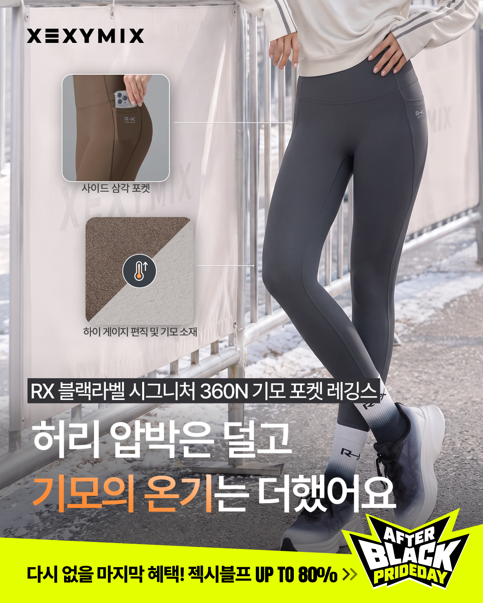
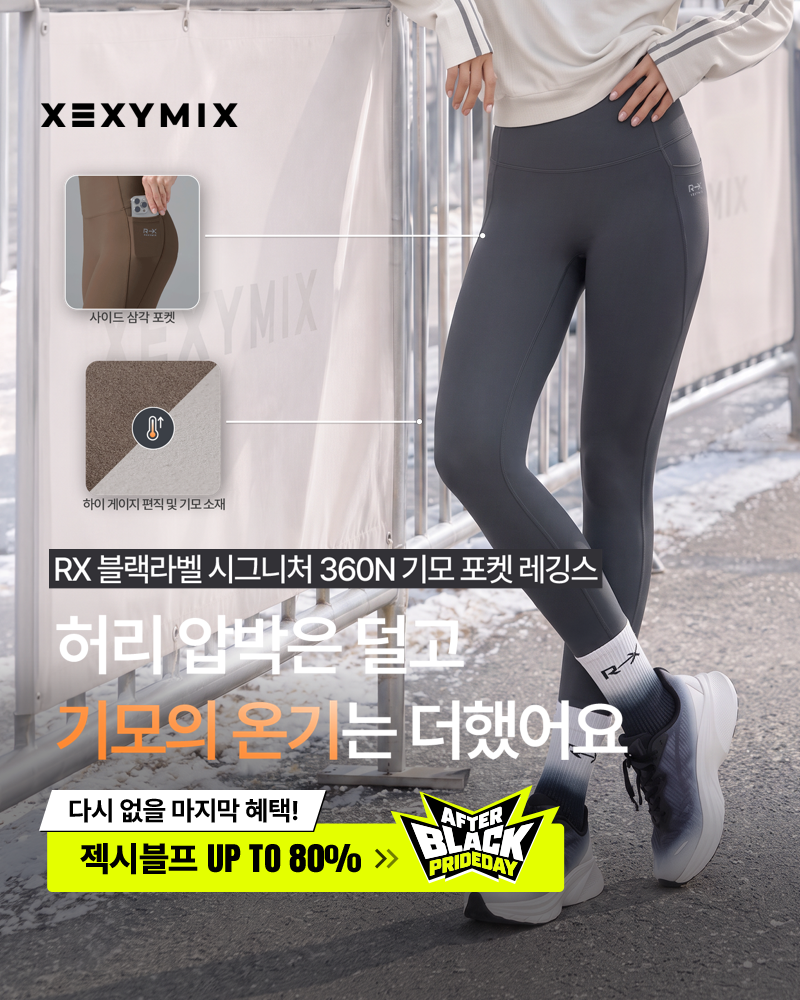
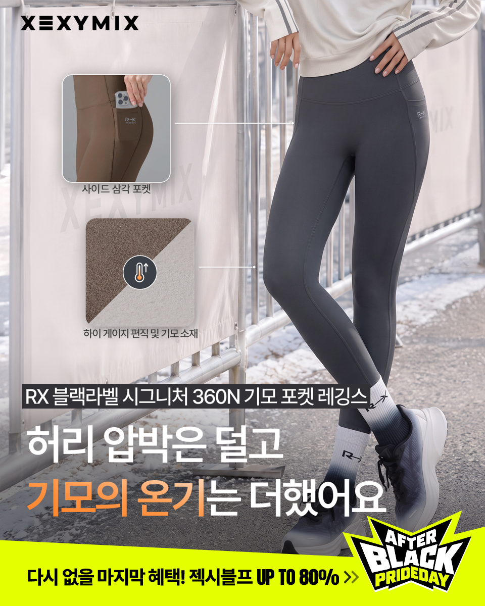
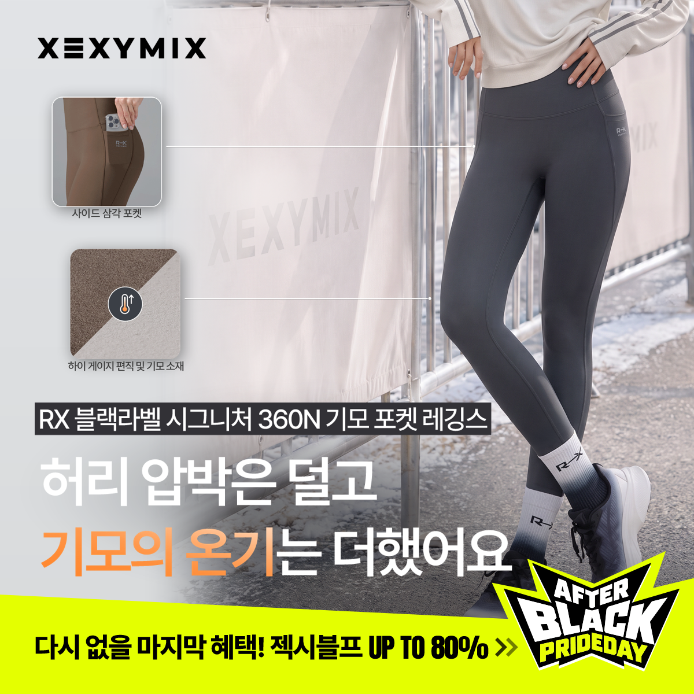
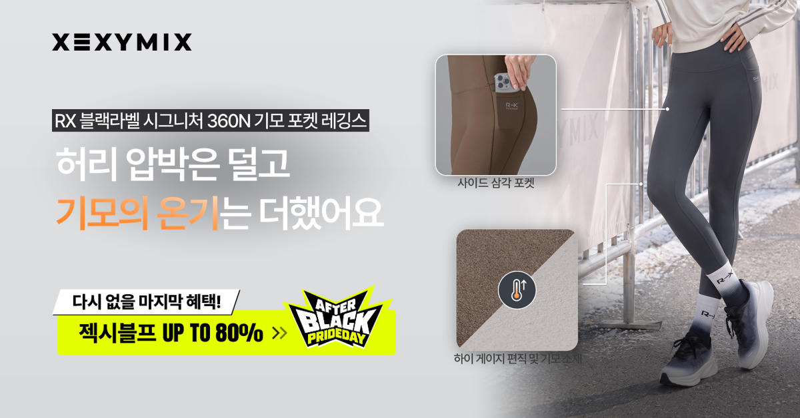
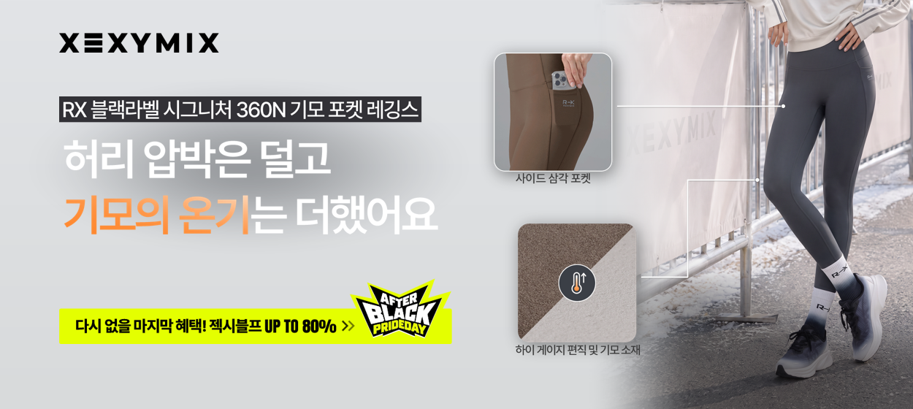
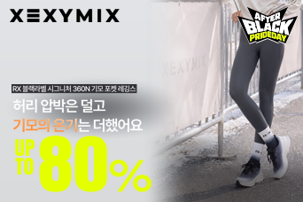

# Task 1 Production Resizing Walkthrough (`TASK1_XEXYMIX_11_SIZES`)

## Pipeline Execution Summary

- **Size Guide Extraction**: `engine/extract_size_guide.py` parsed all 11 artboards from `assets/Task 1 - XEXYMIX/(Size Guide) 애프터블프 딱지 가이드.psd`, wrote `config/task1_size_guide_matrix.json`, and exported 11 native channel-specific promo badges to `assets/brands/xexymix/badges/`.
- **Master Layer Extraction**: `engine/extract_master_assets.py` extracted clean transparent RGBA layers from `11_40462_261106_젝시믹스_상시소재_10차_러닝_RX 블랙라벨 시그니처 360N 기모 포켓 레깅스.psd` to `assets/brands/xexymix/cutouts/`.
- **Deterministic Composition**: `engine/task1_resizer.py` rendered all 11 banners with `Image.Resampling.BICUBIC` into `output/task1_production/TASK1_XEXYMIX_11_SIZES/`.
- **Automated Quality Gate**: `python3 engine/qa_inspector.py --workflow A --task tasks/task1_production/xexymix_11_sizes.json` verified **11/11 PASSED**.

---

## QA Verification Matrix

| # | Placement | Dimensions | Layout | Model | Promo Ribbon / Badge | Feature Cards | QA Status |
|---|---|---|---|---|---|---|---|
| 1 | `meta_story_9_16` | 1440×2560 | Vertical (9:16) | Present (`std=68.5`) | Native pill ribbon (`43.7%`) | Stacked (2 cards) | **PASSED** |
| 2 | `meta_feed_4_5` | 1440×1800 | Vertical (4:5) | Present (`std=73.6`) | Native bottom bar (`49.8%`) | Stacked w/ leader lines | **PASSED** |
| 3 | `kakao_feed_4_5` | 800×1000 | Vertical (4:5) | Present (`std=68.4`) | Native pill ribbon (`42.5%`) | Stacked (2 cards) | **PASSED** |
| 4 | `google_da_4_5` | 960×1200 | Vertical (4:5) | Present (`std=73.2`) | Native bottom bar (`49.4%`) | Stacked w/ leader lines | **PASSED** |
| 5 | `google_da_square` | 1200×1200 | Square (1:1) | Present (`std=75.2`) | Native bottom bar (`50.3%`) | Horizontal row (2 cards) | **PASSED** |
| 6 | `naver_gfa_square` | 1200×1200 | Square (1:1) | Present (`std=75.2`) | Native bottom bar (`50.3%`) | Horizontal row (2 cards) | **PASSED** |
| 7 | `google_da_landscape` | 1200×628 | Wide (1.91:1) | Present (`std=64.7`) | Native pill ribbon (`42.5%`) | Horizontal row (2 cards) | **PASSED** |
| 8 | `naver_gfa_wide` | 1250×560 | Wide (2.23:1) | Present (`std=69.4`) | Native wide ribbon (`41.9%`) | Horizontal row (2 cards) | **PASSED** |
| 9 | `naver_thumb_small` | 342×228 | Micro | Present (`std=65.7`) | Native starburst + `UP TO 80%` | Omitted (Micro rule) | **PASSED** |
| 10 | `naver_smart_channel` | 260×280 | Micro | Present (`std=63.7`) | Native starburst + circle badge | Omitted (Micro rule) | **PASSED** |
| 11 | `kakao_bizboard` | 314×300 | Micro | Present (`std=64.9`) | Native starburst + `~80%` | Omitted (Micro rule) | **PASSED** |

---

## Rendered Thumbnails (11 Placements)

### 1. `meta_story_9_16` (1440×2560)

### 2. `meta_feed_4_5` (1440×1800)

### 3. `kakao_feed_4_5` (800×1000)

### 4. `google_da_4_5` (960×1200)

### 5. `google_da_square` (1200×1200)

### 6. `naver_gfa_square` (1200×1200)

### 7. `google_da_landscape` (1200×628)

### 8. `naver_gfa_wide` (1250×560)

### 9. `naver_thumb_small` (342×228)

### 10. `naver_smart_channel` (260×280)

### 11. `kakao_bizboard` (314×300)

