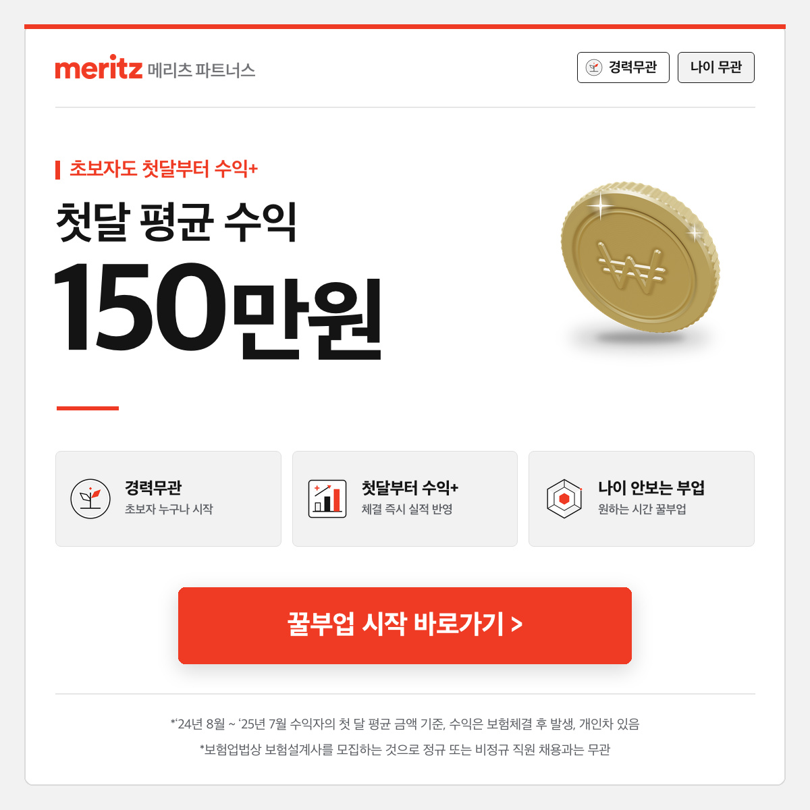

# Task 2 Creative Preparation & Master PSD Walkthrough (`Meritz Partners — Option 1`)

## Pipeline Execution Summary

- **Master PSD Builder**: [`engine/task2_psd_builder.py`](file:///Users/macbookpro/auto-banner-engine/engine/task2_psd_builder.py) ingests brand tokens from [`assets/brands/meritz/tokens.json`](file:///Users/macbookpro/auto-banner-engine/assets/brands/meritz/tokens.json), authentic logo [`assets/logos/meritz/logo.png`](file:///Users/macbookpro/auto-banner-engine/assets/logos/meritz/logo.png), native `Pretendard-*.woff2` fonts (2× supersampled, zero FOUT), and 3D coin visual asset (`assets/brands/meritz/visuals/hero_coin_3d.png` with fallback to `assets/brands/meritz/coin_3d_stack.png`).
- **Master Deliverables**:
  - Layered Photoshop Master: [`deliverables/task2_meritz/meritz_partners_option1.psd`](file:///Users/macbookpro/auto-banner-engine/deliverables/task2_meritz/meritz_partners_option1.psd) (`1200×1200` RGBA, 6 structured layer groups, Photoshop-native UTF-16BE `luni` Korean layer names, embedded composite preview).
  - High-Resolution Preview: [`deliverables/task2_meritz/meritz_partners_preview.jpg`](file:///Users/macbookpro/auto-banner-engine/deliverables/task2_meritz/meritz_partners_preview.jpg) (`1200×1200` RGB, JPEG quality 95, `subsampling=0`).
- **Automated Compliance Gate**: `python3 engine/qa_task2_checker.py --target deliverables/task2_meritz/meritz_partners_option1.psd` verified **6/6 PASSED**.

---

## QA Verification Matrix

```text
=== TASK 2 QA COMPLIANCE CHECKER | deliverables/task2_meritz/meritz_partners_option1.psd ===
------------------------------------------------------------------------------------------------
1. PSD & Preview Integrity     | PASSED | 1200x1200, preview=True, jpg_ok=True
2. Required 6 Layer Groups     | PASSED | found=6/6
3. Top-Left Meritz Logo        | PASSED | bbox=(68, 68, 428, 114), red_px=3437
4. Meritz Red #EF3B24 CTA      | PASSED | #EF3B24_px=110394, white_px=5336, label=True
5. 3D Coin in Headline Zone    | PASSED | in_zone=True, gold_px=26569, std=81.6, overlap=0
6. Mandatory Disclaimers       | PASSED | texts_ok=True, bbox=(214, 1048, 986, 1106), ink_px=9756
------------------------------------------------------------------------------------------------
SUMMARY: 6/6 PASSED | OVERALL: PASSED
```

---

## Final Preview Render (`1200×1200`)


